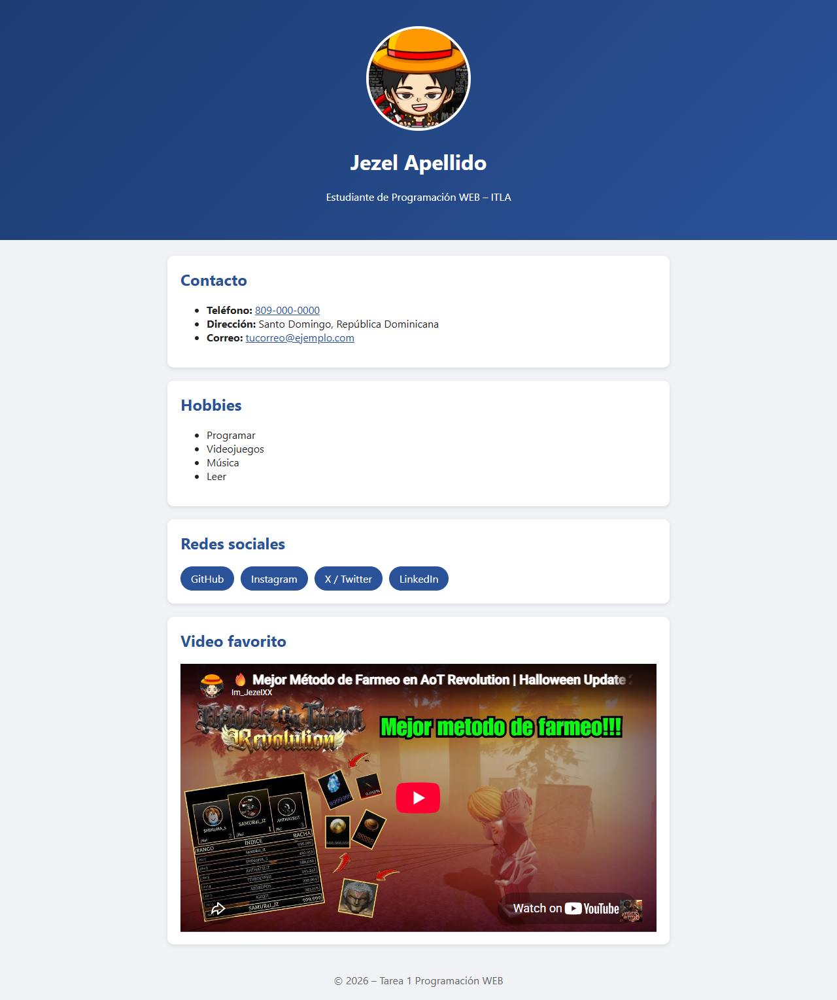
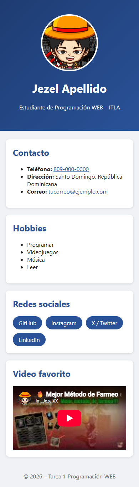

# Tarea 1: Página WEB Personal

Programación WEB – ITLA (2026-C-003)

Página personal hecha con HTML5 y CSS3: foto, nombre, apellido, teléfono, dirección, correo, hobbies, redes sociales y un video de YouTube.

Para verla, abre `index.html` en el navegador.

## Capturas de pantalla

Vista completa en escritorio (1280 px): encabezado con foto y nombre, tarjetas de contacto, hobbies, redes sociales y el video de YouTube incrustado.

Vista en móvil (390 px): el diseño se adapta al ancho de la pantalla, los botones de redes bajan de línea y el video mantiene su proporción 16:9.
